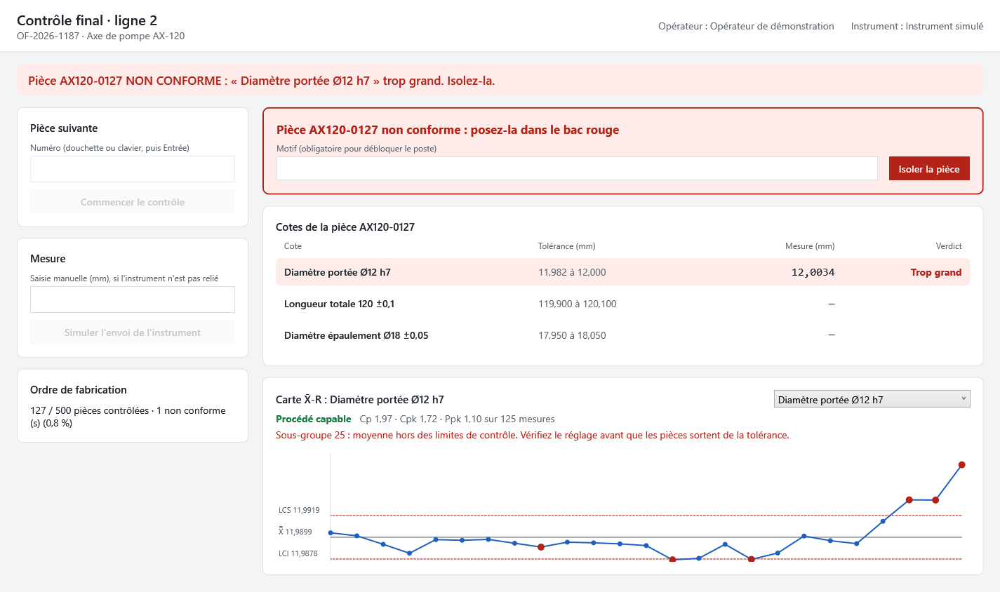

# Poste de contrôle qualité

[](https://github.com/brakan1337/poste-controle-qualite/actions/workflows/ci.yml)

Application Windows de contrôle final pour un atelier d'usinage. L'opérateur scanne la pièce, l'instrument de mesure envoie ses valeurs, le poste juge chaque cote. Une pièce non conforme bloque le poste tant qu'elle n'est pas isolée. La carte de contrôle repère une dérive avant que les pièces sortent de la tolérance.

**C# 14 · .NET 10 LTS · WPF · MVVM · Entity Framework Core · SQL Server · port série · xUnit · GitHub Actions**



*La vraie fenêtre de l'application, rendue par son mode `--capture` sur les données de démonstration.*

## Le brief

> Ce projet est un cas d'étude. Le sous-traitant et ses pièces sont fictifs ; le brief sert à justifier les choix techniques.

Un sous-traitant en mécanique usine des axes de pompe. Au contrôle final, l'opérateur mesure trois cotes au pied à coulisse et au micromètre, puis recopie les valeurs sur une feuille. Les erreurs de recopie sont fréquentes. Une pièce mauvaise finit parfois dans le bac des bonnes. Et personne ne voit l'outil s'user avant le premier rebut.

Ses ateliers tournent sur des PC Windows. Ses instruments se branchent en série (RS-232 ou adaptateur USB). Ses données sont dans SQL Server.

**Pourquoi C# et .NET :** une application Windows native qui lit un port série et écrit dans SQL Server, c'est le terrain naturel de .NET. WPF donne une interface rapide sur les postes d'atelier, sans navigateur. Entity Framework Core parle à SQL Server, et System.IO.Ports aux instruments. Le projet cible **.NET 10, la version LTS**, maintenue jusqu'en novembre 2028 : un poste d'atelier ne se met pas à jour tous les six mois.

## Ce que fait le poste

1. **L'opérateur scanne le numéro de la pièce.** Une pièce déjà contrôlée sur l'OF est refusée dès le scan.
2. **L'instrument envoie une mesure par cote, dans l'ordre du plan.** Le poste lit la trame, convertit l'unité (mm, µm, pouces) et juge la cote. Une saisie manuelle reste possible.
3. **Une cote hors tolérance rend la pièce non conforme.** L'opérateur n'a pas besoin de mesurer le reste.
4. **Une pièce non conforme bloque le poste.** Impossible de scanner la suivante sans l'isoler en saisissant un motif. Le blocage est enregistré en base : redémarrer le poste ne permet pas de passer outre.
5. **La carte de contrôle se met à jour à chaque pièce.**

## La maîtrise statistique des procédés

La partie qui demande un bagage d'ingénieur, dans [`Domaine/Msp`](src/ControleQualite.Domaine/Msp) :

- **Carte X̄-R** : les mesures sont regroupées par sous-groupes de 5 pièces consécutives. Les limites de contrôle (LCS, LCI) se calculent à partir des données, avec les constantes classiques A2, D3, D4 et d2. Elles disent ce que le procédé fait d'habitude, pas ce que le client accepte. C'est pourquoi la carte des moyennes ne trace pas la tolérance du plan.
- **Règles de lecture** : un point hors limites, 7 points de suite du même côté de la moyenne, 6 points de suite qui montent ou descendent. Elles signalent une dérive alors que toutes les pièces sont encore bonnes.
- **Capabilité** : Cp et Cpk avec la dispersion à court terme (R̄ / d2), Pp et Ppk avec la dispersion globale. Sur la capture, Cp 1,97 mais Ppk 1,10 : la machine sait faire, mais le procédé dérive. Les données de démonstration simulent une usure d'outil sur le dernier quart de l'OF.

Les valeurs sont vérifiées à la main dans les tests, par exemple Cp = 24 / (6 × 4 / 2,326) = 2,326.

## Architecture

```
src/
  ControleQualite.Domaine        cotes, verdicts, contrôle d'une pièce, carte X̄-R, règles, capabilité (C# pur)
  ControleQualite.Instruments    lecture des trames, port série, instrument simulé
  ControleQualite.Donnees        Entity Framework Core : SQL Server en production, SQLite pour essayer
  ControleQualite.Presentation   les modèles de vue (MVVM), sans dépendance à WPF
  ControleQualite.Poste          l'application WPF : la fenêtre et la carte dessinée
tests/
  ControleQualite.Tests          44 tests xUnit
```

- **La logique de l'écran ne dépend pas de WPF.** Les modèles de vue vivent dans une bibliothèque `net10.0` ordinaire. Le parcours de l'opérateur (scanner, mesurer, isoler, redémarrer) se teste sans fenêtre, et même sous Linux dans la CI.
- **L'instrument est une interface.** Le port série, l'instrument simulé, ou demain le protocole propre à une marque passent tous par le même décodage. Les mesures arrivent sur le fil du port série et sont ramenées sur celui de l'écran.
- **Le schéma de production est versionné.** Les migrations Entity Framework visent SQL Server, avec un script SQL lisible dans [`docs/schema-sqlserver.sql`](docs/schema-sqlserver.sql). La base empêche de contrôler deux fois la même pièce sur un OF.
- **La qualité de code est verrouillée.** Analyseurs .NET au niveau recommandé, avertissements traités comme des erreurs, et refus des dépendances qui ont une faille connue. C'est ainsi que le projet est passé d'Entity Framework 10.0.0 à 10.0.15.

## Lancer le poste

Avec le SDK .NET 10, sous Windows :

```bash
dotnet run --project src/ControleQualite.Poste
```

Par défaut, le poste démarre sur une base SQLite locale remplie de données de démonstration, avec un instrument simulé : le bouton « Simuler l'envoi de l'instrument » remplace l'appui sur l'instrument. Chez le client, `appsettings.json` pointe vers SQL Server et vers le port de l'instrument :

```json
{
  "Poste": "Contrôle final · ligne 2",
  "Base": "SqlServer",
  "Connexion": "Server=srv-sql;Database=ControleQualite;Trusted_Connection=True;TrustServerCertificate=True",
  "Instrument": "COM3",
  "Demonstration": false
}
```

La capture du README se régénère avec :

```bash
dotnet run --project src/ControleQualite.Poste -- --capture docs/poste.png
```

## Tests

```bash
dotnet test
```

- **Domaine** : tolérances et limite pile atteinte malgré la virgule flottante, ordre des cotes, pièce non conforme.
- **MSP** : limites de la carte, capabilité centrée et décentrée, Pp sous Cp quand le procédé dérive, chaque règle de lecture, procédé stable sans signal.
- **Instruments** : trames courantes et illisibles, unités.
- **Base** : enregistrement, doublon refusé, quarantaine, historique, et carte de démonstration qui voit l'usure venir.
- **Poste** : le parcours de l'opérateur de bout en bout, le blocage qui survit à un redémarrage, la saisie à la virgule.

La CI rejoue les tests de la base sur un vrai SQL Server 2022 avec les migrations. Elle vérifie qu'aucune migration n'a été oubliée, compile l'application WPF sous Windows, puis la lance en mode capture pour prouver qu'elle démarre.
